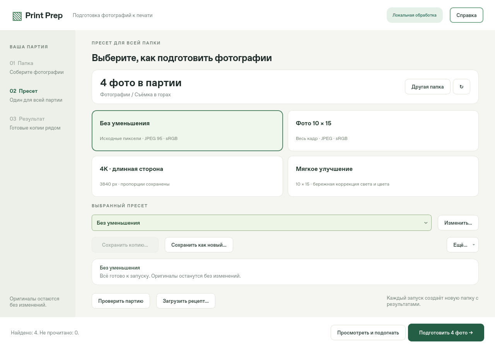

# Print Prep 2.2

A local Windows app that prepares a whole folder of photos for printing.
**Open a folder → pick a preset → “Prepare”.** Originals are never changed; the results land in a
`PrintPrep_…` subfolder next to them. Everything runs offline on your computer.
Requires Windows 10/11 x64.



*All screenshots here use synthetic demo images, not real photos.*

[Light theme](docs/interface_light.png) · [Start screen](docs/start.png) · [Before / after](docs/compare.png) ·
[Per-photo edits](docs/photo.png) · [Crop](docs/crop.png) · [Neural network at work](docs/neural_progress.png) ·
[Neural result](docs/neural.png) · [1:1 zoom](docs/neural_1to1.png) · [Preset manager](docs/presets.png) ·
[App settings](docs/settings.png) · [First-run tour](docs/tour.png) · [Splash](docs/splash.png)

The interface speaks **English and Russian** and comes in **dark, light or “as in Windows”** themes.

## What it does

- **One workspace.** Presets on the left, a live preview with a filmstrip in the middle, the preset
  card, histogram and settings on the right. Every change is visible immediately — there is no
  “Apply” button. Ctrl+Z / Ctrl+Y undo and redo.
- **Presets are the main idea.** One click applies a preset to every photo in the folder. The selected
  preset is outlined, and a banner says plainly that you are editing that preset and the change goes
  to all photos. Built-in groups collapse; your own presets live in “Mine”. Save, save as, rename,
  duplicate, export/import files, and a separate preset manager.
- **Per-photo edits** on top of the preset (“This photo” tab): crop, rotation, straighten, light,
  colour, neural network. Copy them to selected photos or move them into the preset. Edits are saved
  per folder automatically.
- **Smart auto correction**, measured rather than guessed (`tools/eval_auto.py`):
  - white balance by voting of near-neutral surfaces in log-chroma space, textured surfaces weighted
    above smooth sky and backdrops; a real cast is corrected almost fully, while warm scene light
    (sunset, lamps) is kept because it leaves the shadows neutral; detected skin must stay natural;
  - exposure from the log-average and the highlight headroom, with faces as a second opinion; dark
    low-key and bright high-key frames are left alone;
  - auto levels at 0.1 % clipping only when both ends of the histogram are empty; shadows lifted only
    where they hold detail (a black backdrop stays black); strong veils go to a dark-channel dehaze.

  Measured by adding known faults (colour casts, ±EV, flat contrast, haze) to good photos and
  averaging ΔE (CIELAB) to the original: on six real photographs from the Windows image set
  (landscapes, sunset, fog) it removes **43 %** of the colour error and changes the good originals by
  only ΔE 1.89. On a stress set of 19 images (wallpapers, including 3D abstractions) the figures are
  28 % and ΔE 3.15; on the 24 Kodak film scans, 34 % and ΔE 2.06. Results depend on the photos — see
  the [research notes](docs/RESEARCH.md) (in Russian).
- **Manual grading like Lightroom** (exposure, contrast, highlights, shadows, whites, blacks,
  temperature, tint, vibrance, saturation, clarity, dehaze, noise) and nine styles.
- **One neural network — Real-ESRGAN.** Restores detail and cleans JPEG artefacts when a photo has to
  be enlarged 1.3× or more (sources up to 4 MP). It runs once per photo in the background with
  progress and time left, and the result shows right in the preview. The best settings are automatic;
  an “Advanced” dialog offers strength and a *clean ↔ detail* control (Real-ESRGAN’s official denoise
  interpolation plus returned source texture), so the result no longer looks smeared.
- **Printing.** mm + PPI, exact pixels, long edge or original size; smart framing on faces, borders,
  safe zone; output sharpening for screen, gloss or matte; print-brightness compensation; printer
  ICC profiles with soft proof and gamut warning.
- **Quality.** float32 throughout, 16-bit TIFF/PNG in and out, exact Display P3 / Adobe RGB
  conversion, EXIF without GPS, dithering.
- **Fast on weak PCs.** Previews decode a reduced JPEG (DCT scaling) instead of the full file; the full
  resolution is read only for 1:1, the neural network and export. Neighbouring photos are prefetched,
  so switching after viewing takes ~0.03 s; a slider drag redraws in ~0.06 s. Export runs strips in
  parallel. The build is a folder (fast start, antivirus-friendly), ~75 MB zipped.
- **Friendly.** An animated splash while the heavy modules load, a short spotlight tour on first run
  (repeat it from App settings), toolbar that switches to icons in narrow windows.

## Build and run

**Downloads.** Get `PrintPrep-Setup.exe` (installer) or `PrintPrep-Windows-x64.zip` (portable) from the
[latest release](https://github.com/nikserbur/printprep/releases/latest); `SHA256SUMS.txt` next to them
has the checksums. Builds of unreleased commits are attached to each successful “Windows build” run in
the [Actions tab](https://github.com/nikserbur/printprep/actions) (downloading them requires signing in
to GitHub, and GitHub keeps them for a limited time). You can also build the app yourself with
`build_exe.bat` (below).

**One file, one button.** `PrintPrep-Setup.exe` (from the release, or built into `dist/`) →
“Install”. It installs per user (no admin rights) into `%LOCALAPPDATA%\Programs\Print Prep`, adds
desktop and Start menu shortcuts, registers in Settings → Apps (uninstall from there) and starts the
app. Updating is the same: run the new setup, presets are kept. The setup is not code-signed, so
SmartScreen may ask for “More info → Run anyway”. A portable `dist/PrintPrep-Windows-x64.zip` is built
as well.

**Building:** on Windows with Python 3.12 x64 run `build_exe.bat`. It runs the tests, builds the
app folder, checks its self-test, packs the ZIP, builds the installer (`installer/`) and verifies
it with a silent install → self-test → uninstall (`tools/check_installer.py`).

From source:

```bat
py -3.12 -m venv .venv
.venv\Scripts\python -m pip install -r requirements.txt
.venv\Scripts\python print_prep.py
```

Tests (`requirements-dev.txt` adds pytest and PyInstaller; this is what `build_exe.bat` runs):

```bat
.venv\Scripts\python -m pip install -r requirements-dev.txt
set QT_QPA_PLATFORM=offscreen
.venv\Scripts\python -m pytest -q
```

Tools: `tools/eval_auto.py <folder of good JPEGs>` — objective check of auto correction;
`tools/profile_workflow.py` — speed of every step; `tools/screenshot_demo.py` — regenerate the
screenshots above; `tools/make_icon.py` — the logo.

More: [user guide (EN)](README_EN.txt) · [инструкция (RU)](README.txt) · [research and measurements](docs/RESEARCH.md) (in Russian) ·
[acceptance checklist](docs/ACCEPTANCE.md) (in Russian) · [third-party components](THIRD_PARTY.md) (in Russian) ·
[bundled models](assets/models/README.md).

Limits: no RAW/HEIC and no direct printing. The working space is sRGB (wide gamut is compressed
gently). Output to a printer ICC profile is 8-bit only.

The logo is an original abstract composition after Kandinsky’s *Several Circles*: glowing discs that
read as lenses and paint at once, seen through viewfinder corners.

## License

See [LICENSE](LICENSE). The licenses/ folder contains third-party license texts only; see [THIRD_PARTY.md](THIRD_PARTY.md).
